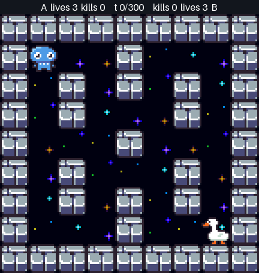

# BOMBcompeTItion

A two-player bomb game for the class bot competition.

<p align="center"></p>

## Game Overview

Two players start in opposite corners of a fixed 9x9 map with walls. Every step both choose an action
at the same time: move, stay, or drop a bomb. A bomb explodes a few steps later in a cross and stops at
walls. A player caught in an explosion loses a life, and both players restart from their corners. You
score a **kill** when your bomb hits the opponent. A game ends when someone has no lives left or after
300 steps.

Each team writes one bot. Bots play each other in a league and are ranked by kills.

Full rules: [docs/rules.md](docs/rules.md).

## Table of Contents

- [Getting Started](#getting-started)
- [Observation and Action](#observation-and-action)
- [Usage](#usage)
- [Competition](#competition)
- [Open questions (TAs)](#open-questions-tas-remove-before-release)

---

## Getting Started

```bash
git clone https://github.com/ahn-ml/BOMBcompeTItion.git
cd BOMBcompeTItion
pip install -e .    # Python >= 3.10; numpy, gymnasium, pillow
```

Check that it works by playing the example bot against itself:

```bash
python run_match.py --p1 examples/simple --p2 examples/simple
```

---

## Observation and Action

Every step a bot gets `obs`, a dict with the full game state. B sees the board turned 180° and its actions
are read in that view, so both players see themselves starting top-left.

| Key | Value |
|---|---|
| `player` | 0 if you are A, 1 if you are B |
| `walls` | numpy bool array `(9, 9)`, `walls[row, col]`; row 0 is the top |
| `me`, `opp` | `(row, col)` of you and the opponent |
| `bombs` | tuple of `{"pos": (row, col), "owner": 0 or 1, "fuse": steps until it explodes}` |
| `lives` | `(yours, opponent's)` |
| `step` | steps played so far (the game ends at 300) |

The bot returns one action:

| 0 | 1 | 2 | 3 | 4 | 5 |
|---|---|---|---|---|---|
| STAY | UP | DOWN | LEFT | RIGHT | BOMB |

How you turn `obs` into features or a tensor is up to you. `legal_actions(obs)` lists the actions that
are not blocked.

---

## Usage

The game runs in plain Python without rendering, at about 100,000 steps per second on one CPU core.
There are two interfaces.

### `Game`: both players' actions

```python
from bombcompetition import Action, Game

game = Game()
while not game.done:
    obs_a, obs_b = game.obs(0), game.obs(1)        # what A and B see
    deaths = game.step(Action.UP, Action.BOMB)     # A's action, B's action
```

`game.step` returns who was hit in that step as a list of `Death(player, killer)` (`killer` is `None`
when a player hit itself). Use it for self-play or to simulate ahead.

### `BomberEnv`: one action, a fixed opponent

A [Gymnasium](https://gymnasium.farama.org/) env for reinforcement learning. You play one side and
`opponent`, any `obs -> action` function, plays the other.

```python
from bombcompetition import BomberEnv, load_policy

opponent = load_policy("examples/simple")()
env = BomberEnv(opponent=opponent.act, player=0)   # player=1 to play as B
obs, info = env.reset()
obs, reward, terminated, truncated, info = env.step(action)
```

| | |
|---|---|
| observation | the `obs` dict (`env.observation_space` is a `spaces.Dict`) |
| action | `Discrete(6)` |
| reward | by default +1 when your bomb hits the opponent, -1 when you lose a life |
| terminated / truncated | someone has no lives left / the step limit is reached |
| info | `deaths`, `lives`, `kills` |

### Custom reward and rules

Both are set from your own code; you do not change the package.

```python
from bombcompetition import BomberEnv, Rules

def my_reward(prev_obs, action, obs, deaths):     # called after every step
    me = obs["player"]
    reward = sum((d.killer == me) - (d.player == me) for d in deaths)   # the default reward
    return reward - 0.01                                                 # plus a small cost per step

env = BomberEnv(opponent=opponent.act, reward_fn=my_reward, rules=Rules(max_bombs=2, lives=5))
```

`Rules` values you leave out keep the defaults in `RULES`. `run_match.py` and the league always use
the default `RULES`.

---

## Competition

### Step 1: Write your bot (`submission/policy.py`)

```python
class Policy:
    def __init__(self):   # once per game; load model weights here
        ...

    def act(self, obs):   # every step; return an int from 0 to 5
        ...
```

A new `Policy` is created for every game. Load files relative to the folder:
`Path(__file__).parent / "weights.npz"`. Examples: `examples/simple` (reads `obs` and acts, weak) and
`examples/greedy` (dodges bombs and chases the opponent).

> **Note:** if `act` raises an exception or returns something other than 0-5, the bot stays for that
> step and it counts as a fault. Time limits: TBD.

### Step 2: Test it

```bash
python run_match.py --p1 submission --p2 examples/simple --games 20
```

`--p1` plays A and `--p2` plays B; any bot folder works for either. Swap them to test the other side.

```
p1 submission: 0W 20D 0L  kills 0  deaths 31  faults 0  slowest act 0 ms
p2 examples/simple: 0W 20D 0L  kills 31  deaths 31  faults 0  slowest act 0 ms
```

Add `--replay replay.json` to save one game, then open `web/replay.html` in a browser and load the file.
You can step through the game and see both players' actions at every step.

### Step 3: Submit

Zip the contents of `submission/` (with `policy.py` at the top) as `<team>.zip` and upload it to TBD by TBD.
Allowed libraries: TBD.

### What you can change

| Path | |
|---|---|
| `submission/` | Yours. Change anything, add files. This is what you hand in. |
| New files you create | Yours: training scripts, notebooks, other bots to test against. Not handed in. |
| `examples/` | Read and copy. |
| `bombcompetition/` | Do not change. The league uses its own copy. Reward, rules and opponent are arguments of `BomberEnv`, so training needs no changes here. |
| `run_match.py`, `league.py`, `web/`, `tests/`, `tools/` | Do not change. |

### Official evaluation

Every pair of teams plays TBD games, swapping sides. Teams are ranked by total kills against other
teams, together with results against TA bots (TBD). The league runs with `league.py`.

---

## Open questions (TAs, remove before release)

1. Game rules: map, number of bombs, fuse, blast radius, lives, game length.
2. Winning condition: careful bots that only dodge almost never get killed, so games between good bots
   end in draws. How to discourage pure defence: rank by total kills, add results against TA bots, change rules?
3. Submission format and Python environment: allowed libraries and versions (torch?), time limit per `act`,
   how and when to submit. Students and the league machine should use the same environment.
4. A training example: e.g. PPO (runnable on Colab) and how to submit the trained model.
5. Release: publish to students as a new repository without this repository's history.

Board sprites from [CoderOne Bomberland](https://github.com/CoderOneHQ/bomberland) (MIT).
