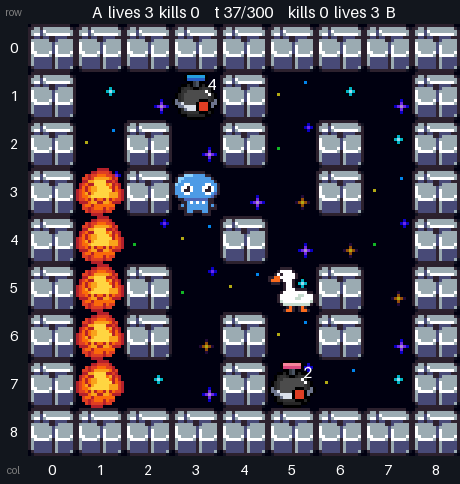

# BOMBcompeTItion

A two-player bomb game for the class bot competition. Each team writes one bot; bots play each other
in a league and are ranked by kills.

<p align="center"></p>

## Setup

```bash
pip install -e .    # Python >= 3.10
```

## Rules

<p align="center"></p>

The board is a fixed 9x9 map. Cells are `(row, col)` with row 0 at the top. Player A starts at `(1, 1)`,
player B at `(7, 7)`. Grey blocks are walls.

Each step both players choose one action at the same time:

| 0 | 1 | 2 | 3 | 4 | 5 |
|---|---|---|---|---|---|
| STAY | UP | DOWN | LEFT | RIGHT | BOMB |

A step is resolved in this order:

1. Bombs are dropped on the players' cells (at most 2 bombs per player on the board).
2. Players move. Walls, bombs and the other player's cell block a move. If both move into the same cell, neither moves.
3. Every bomb's fuse goes down by 1. A bomb at 0 explodes: its cell and up to 2 cells in each direction,
   stopped by walls. An explosion that reaches another bomb sets it off too.
4. A player in an explosion loses a life. Then both players go back to their start cells and all bombs are removed.

A bomb explodes 5 steps after the step it was dropped in. Each player has 3 lives. If the opponent's
bomb was part of the explosion that hit you, the opponent gets a kill; your own bomb gives no kill.
The game ends when someone has no lives left or after 300 steps.

The values are in `bombcompetition.RULES`.

## Your bot

A bot is a folder with a `policy.py`. Write yours in `submission/policy.py`:

```python
class Policy:
    def __init__(self):   # once per game
        ...

    def act(self, obs):   # every step, returns 0-5
        ...
```

If `act` raises an exception or returns something else, the bot stays for that step (a fault).
Time limits: TBD.

`obs` is a dict, the same board for both players:

| key | value |
|---|---|
| `player` | 0 if you are A, 1 if you are B |
| `walls` | numpy bool array `(9, 9)`, `walls[row, col]` |
| `me`, `opp` | `(row, col)` of you and the opponent |
| `bombs` | tuple of `{"pos": (row, col), "owner": 0 or 1, "fuse": steps until it explodes}` |
| `lives` | `(yours, opponent's)` |
| `step` | steps played so far (the game ends at 300) |

What you do with it is up to you. `legal_actions(obs)` returns the actions that are not blocked.
`examples/simple/policy.py` is a small example bot.

## Running games

```bash
python run_match.py --p1 submission --p2 examples/simple --games 20
```

`--p1` plays A and `--p2` plays B; any bot folder works for either. It prints wins, draws, losses,
kills, deaths and faults for each bot:

```
p1 submission: 0W 12D 8L  kills 0  deaths 36  faults 0  slowest act 0 ms
p2 examples/simple: 8W 12D 0L  kills 36  deaths 27  faults 0  slowest act 0 ms
```

Add `--replay replay.json` to also save one game. Open `web/replay.html` in a browser and load the
file to step through it; each step shows the actions both players chose.

## Environment

For training or simulation you can use the game directly from Python. Nothing is rendered unless you ask for it.

`BomberEnv` is a [Gymnasium](https://gymnasium.farama.org/) env: you play one side and `opponent`
(any `obs -> action` function, e.g. another bot or an older copy of yours) plays the other.

```python
from bombcompetition import BomberEnv, load_policy

opponent = load_policy("examples/simple")()
env = BomberEnv(opponent=opponent.act, player=0)   # player=1 to play as B
obs, info = env.reset()
obs, reward, terminated, truncated, info = env.step(action)
```

| | |
|---|---|
| observation | the `obs` dict above (`env.observation_space` is a `spaces.Dict`) |
| action | `Discrete(6)` |
| reward | +1 when your bomb hits the opponent, -1 when you lose a life |
| terminated / truncated | someone has no lives left / the step limit is reached |
| info | `deaths` (who was hit this step and by whom), `lives`, `kills` |
| `env.game` | the full game state, e.g. for your own reward |

`Game` runs a game where you choose both players' actions, e.g. for self-play:

```python
from bombcompetition import Game

game = Game()
while not game.done:
    deaths = game.step(action_a, action_b)   # returns who was hit this step
    obs_a, obs_b = game.obs(0), game.obs(1)
```

Both take the rules as an argument, so you can also train on other settings:

```python
from bombcompetition import Rules

rules = Rules(max_bombs=3, fuse=8, lives=5)   # unspecified values keep the defaults in RULES
env = BomberEnv(opponent=opponent.act, rules=rules)
```

`run_match.py` and the league always use the default `RULES`.

## Submission

Zip the contents of `submission/` (with `policy.py` at the top) as `<team>.zip` and upload it to TBD by TBD.
Only change files in `submission/`; the league uses its own copy of `bombcompetition/`.
Allowed libraries: TBD.

## Evaluation

Every pair of teams plays TBD games, swapping sides. Teams are ranked by total kills against other teams,
together with results against TA bots (TBD). The league is run with `league.py`.

## Open questions (TAs, remove before release)

1. Game rules: map, number of bombs (2 or 3), fuse, blast radius, lives, game length.
2. Winning condition: careful bots that only dodge almost never get killed, so games between good bots
   end in draws. How to discourage pure defence: rank by total kills, add results against TA bots, change rules?
3. Submission format and Python environment: allowed libraries and versions (torch?), time limit per `act`,
   how and when to submit. Students and the league machine should use the same environment.
4. A training example: e.g. PPO (runnable on Colab) and how to submit the trained model.
5. Release: publish to students as a new repository without this repository's history.

Board sprites from [CoderOne Bomberland](https://github.com/CoderOneHQ/bomberland) (MIT).
