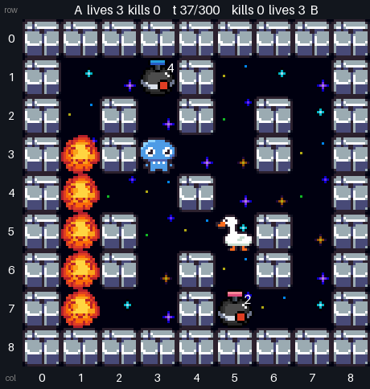

# Game rules

<p align="center"></p>

## Board

- A fixed 9x9 map. Cells are `(row, col)`: row 0 is the top, col 0 is the left.
- Grey blocks are walls. They never change, block movement and stop explosions. The border is all walls.
- Player A starts at `(1, 1)`, player B at `(7, 7)`. The map looks the same after a 180° rotation,
  so neither side has an advantage. Each bot sees the board from its own side (B's view is turned 180°).
- In the picture: A is at `(3, 3)`, B at `(5, 5)`. The number on a bomb is the steps left until it
  explodes. The fire shows the cells hit by a bomb that exploded at `(5, 1)` in this step.

## Actions

| Value | Action | Effect |
|---|---|---|
| 0 | STAY | do nothing |
| 1 | UP | move to `(row - 1, col)` |
| 2 | DOWN | move to `(row + 1, col)` |
| 3 | LEFT | move to `(row, col - 1)` |
| 4 | RIGHT | move to `(row, col + 1)` |
| 5 | BOMB | drop a bomb on your cell |

An action that is not possible does nothing.

## One step

Both players act at the same time. A step is resolved in this order:

1. **Bombs are dropped.** A player who chose BOMB drops a bomb on its cell, unless there is already a
   bomb there or the player already has 3 bombs on the board.
2. **Players move.** A move fails if the target cell is a wall, has a bomb, or is where the other player
   stands at the start of the step. If both players move into the same cell, neither moves. You can
   stand on a bomb you just dropped, but you cannot step back onto a bomb's cell once you leave it.
3. **Fuses tick.** Every bomb's fuse goes down by 1. A bomb at 0 explodes.
4. **Explosions.** An explosion covers the bomb's cell and up to 2 cells in each of the four directions.
   A wall stops it (the wall cell is not hit). An explosion that reaches another bomb sets it off in the
   same step and continues past it.
5. **Hits.** A player on an exploded cell loses a life. Both players can be hit in the same step.
6. **New round.** If anyone was hit and the game is not over, both players return to their start cells
   and all bombs are removed.

## Bomb timing

A bomb starts with fuse 5, and the fuse already goes down in the step it is dropped. So right after
you drop a bomb the observation shows `fuse = 4`, and you can make 4 more moves before it explodes at
the end of the 4th step. In general, a bomb with `fuse = f` explodes at the end of the `f`-th step from now.

## Lives, kills and the end of a game

- Each player has 3 lives.
- If a bomb of the opponent was part of the explosion that hit you, the opponent gets a kill.
  Your own bombs can hit you, but that gives no kill to anyone.
- The game ends when a player has no lives left, or after 300 steps.
- The player with more lives left wins the game; equal lives is a draw. The league ranks teams by kills.

## Values

All numbers above come from `bombcompetition.RULES`:

```python
Rules(layout=MAP, starts=None, fuse=5, radius=2, max_bombs=3, lives=3, max_steps=300)
```
